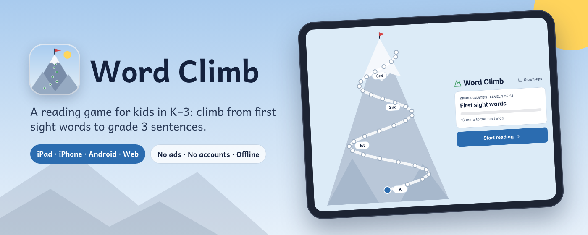

# Word Climb ⛰️



A reading game for kids in kindergarten through grade 3. The child climbs a
mountain one level at a time, from their first sight words to long grade 3
sentences:

- **Sight words**: the Dolch lists (pre-primer through grade 3, plus the nouns)
- **Phonics**: CVC words, blends and digraphs, silent e and vowel teams,
  tricky spellings, two- and three-syllable words
- **Phrases and sentences**: written for the game against a controlled
  vocabulary, so a sentence only uses words the ladder has already taught

The child reads each card out loud and a grown-up answers one question: did
they read it without help? **Yes** or **Not yet**, then on to the next card. A
"Not yet" card comes back a few cards later for another try. Spaced
repetition (SM-2, the
algorithm behind Anki) decides when each card comes back. A card counts as
known once it's read without help on two different days, and the next level
opens when 80% of the current one is known.

The **Grown-ups** report shows where the child is on the ladder, words known,
days practiced, how the last week went, and the words that keep tripping them
up.

It runs on **iPad and iPhone, Android, and in the browser**. It works offline,
has no ads, no accounts and no tracking, and keeps all progress on the device.

**Try it in a browser:** <https://icodeforbananas.github.io/word-climb/>

## Download

| Platform | How                                                                                                                                       |
| -------- | ----------------------------------------------------------------------------------------------------------------------------------------- |
| Android  | Google Play (coming soon), or the `.apk` on the [latest release](../../releases/latest)                                                   |
| iOS      | App Store (coming soon), or sideload the `.ipa` from the latest [CI run](../../actions/workflows/ci.yml)                                   |
| Web      | <https://icodeforbananas.github.io/word-climb/>, then tap **Install** on the home screen (on iPhone/iPad: Share → Add to Home Screen) |

## How it works

- `src/lib/wordClimbContent.ts`: the ladder, every level and card, easiest
  first. The comment at the top explains where the word lists come from.
- `src/lib/wordClimbSchedule.ts`: SM-2 scheduling, the two-day rule for a
  card being known, unlocking levels, and building each 25-card round.
- `src/lib/readingLog.ts`: what's saved on the device and the parent report
  built from it.
- `src/WordClimbApp.tsx`: the home (mountain) and reading screens.
- `src/ParentReport.tsx`: the grown-ups' report.
- `src/pwa.ts`: web-only install support (offline play, install prompt).
- `android/` and `ios/`: native shells, generated by
  [Capacitor](https://capacitorjs.com), that load the built web app.

Progress lives in `localStorage` under `word-climb-cards` (each card's
schedule) and `word-climb-log` (days practiced, recent grades, and when each
card became known).

## Develop

You need Node 22. For the native apps you also need JDK 21 and the Android
SDK (Android Studio installs both) for Android, and a Mac with Xcode for iOS.

```
npm install
npm run dev        # http://localhost:5173
npm test           # content, scheduler and report tests
npm run android    # build, sync and open in Android Studio
npm run ios        # build, sync and open in Xcode (macOS only)
```

No Mac or Android Studio? Push a branch or open a pull request: CI builds an
Android `.apk` and an unsigned iOS `.ipa` and attaches them to the run.

See [CONTRIBUTING.md](CONTRIBUTING.md) to get involved, and
[docs/RELEASING.md](docs/RELEASING.md) for how releases reach the stores.

## License

[MIT](LICENSE)
